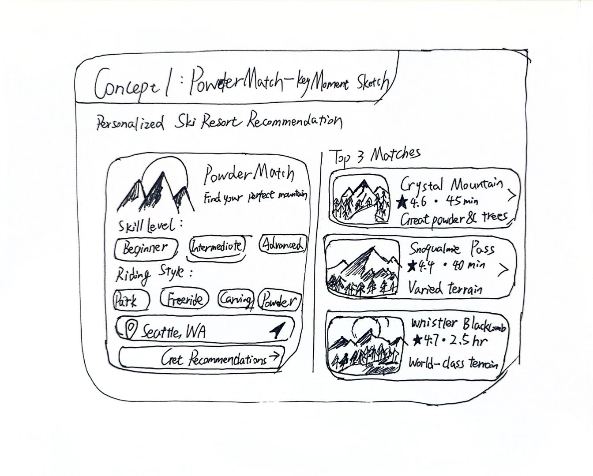
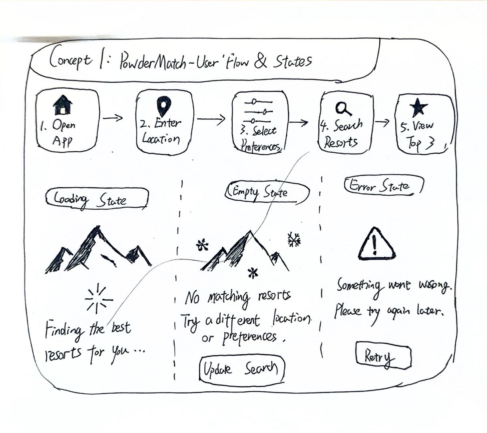
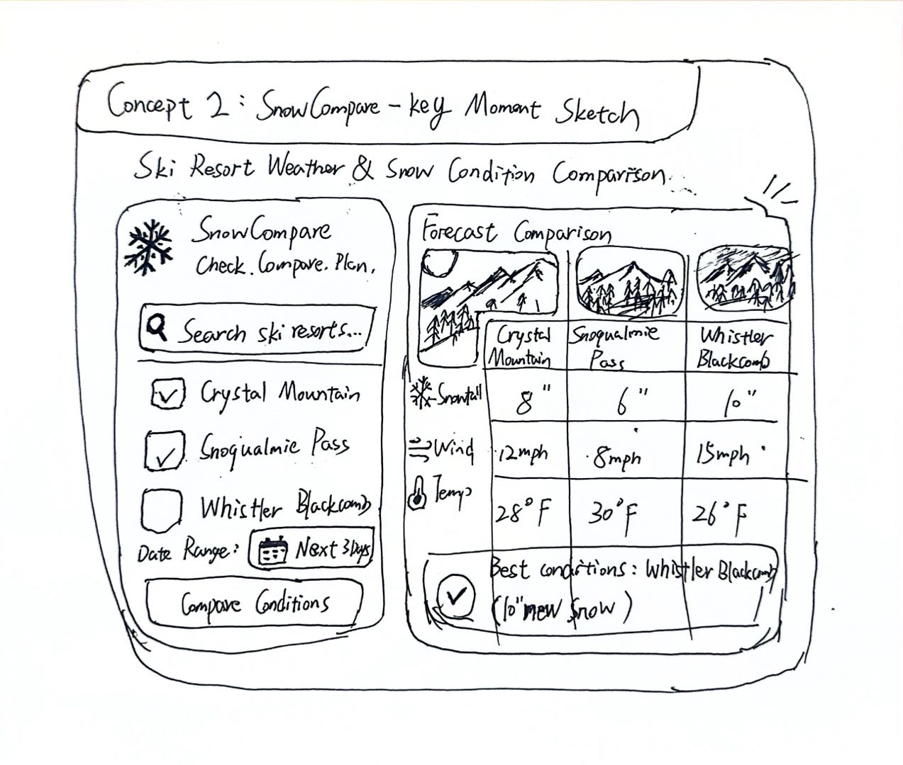
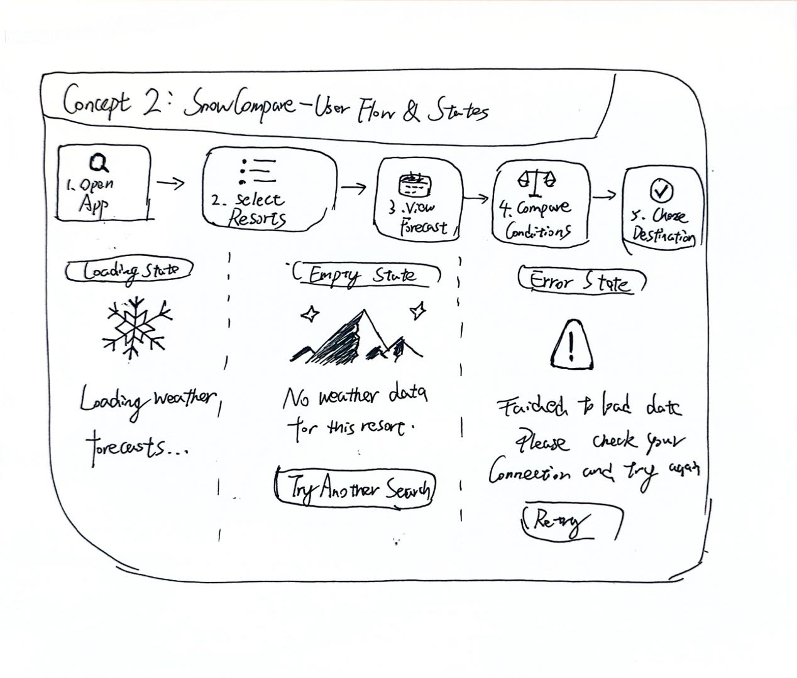
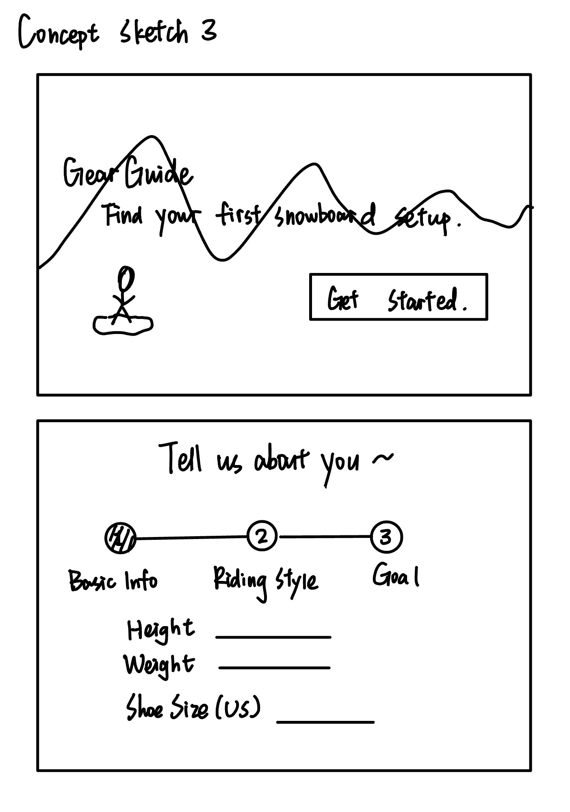
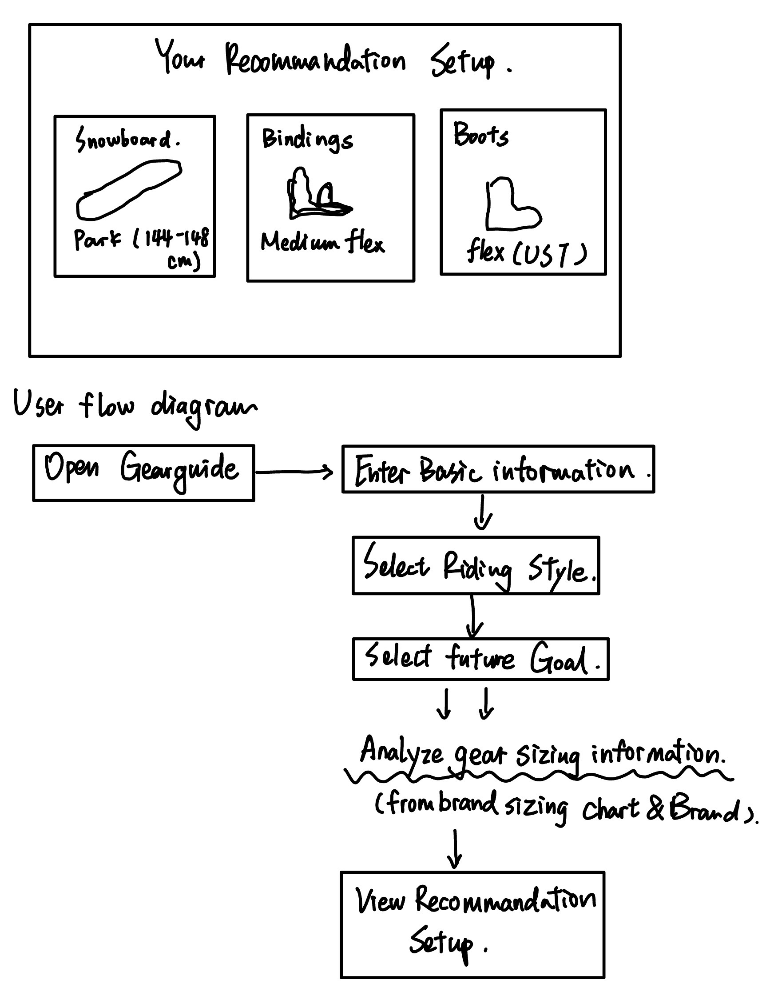

# HCDE 310 Final Project — P1: Concept Sketches

## Concept 1: PowderMatch
### Personalized Ski Resort Recommendation System

#### What It Is

PowderMatch is a personalized ski resort recommendation system that helps snowboarders find resorts that match their skill level, riding style, and location.

Instead of researching different resorts individually, users enter their preferences and receive three recommendations ranked by how well each resort matches their needs.

#### Who It's For

Snowboarders in Washington State, especially beginner and intermediate riders who are unfamiliar with nearby ski resorts and want to find terrain that matches their abilities and riding preferences.

#### Main Features

- Users enter their location to find nearby ski resorts.
- Users select their skill level: Beginner, Intermediate, or Advanced.
- Users select their preferred riding style: Park/Freestyle, Freeride/Big Mountain, Carving, or Powder Riding.
- The system retrieves nearby ski resorts and analyzes their terrain characteristics.
- The system compares trail difficulty, trail length, slope, and elevation information with the user's preferences.
- Users receive the top three matching ski resorts, along with explanations for each recommendation.

#### Value It Adds

Different snowboarders may prefer different types of terrain, even if they have the same skill level. PowderMatch combines resort locations, trail characteristics, elevation information, and individual preferences to provide personalized recommendations.

Instead of choosing a resort based only on popularity or distance, users can discover resorts that better match their riding abilities and interests.

#### Potential Outside Resources

1. **[OpenSkiData](https://www.openskidata.org/)**

   OpenSkiData provides open datasets containing ski area locations, ski runs, lifts, and points of interest. Its data includes trail difficulty, length, grooming, slope, elevation profiles, and other terrain characteristics.

   The system can use this dataset to identify nearby resorts and compare their trail characteristics with users' skill levels and riding styles.

2. **[USGS 3D Elevation Program (3DEP)](https://www.usgs.gov/3d-elevation-program)**

   USGS 3DEP provides publicly available elevation data and digital elevation models.

   The system can use elevation data to supplement resort terrain information, such as elevation differences and mountain topography. This information can provide additional context when comparing resorts.

#### Depth Item: Many Lenses

PowderMatch combines multiple sources of information about ski resorts, including trail characteristics, resort locations, elevation data, and users' personal preferences.

By combining these different perspectives, the system provides personalized resort recommendations rather than simply displaying individual resort information.

#### Initial User Flow

1. Open PowderMatch.
2. Enter a location.
3. Select skill level and preferred riding style.
4. The system retrieves nearby ski resorts.
5. The system analyzes trail difficulty, terrain characteristics, and elevation information.
6. View the top three recommended resorts and the reasons behind each recommendation.

#### Empty, Loading, and Error States

- **Loading State:** The system displays a loading indicator and a message such as "Finding the best resorts for you..." while retrieving and analyzing resort data.
- **Empty State:** If no resorts match the selected preferences or location, the system displays "No matching resorts found" and suggests changing the search location or preferences.
- **Error State:** If resort data cannot be retrieved or processed, the system displays an error message and provides a retry option.

#### AI Note

AI could help rank ski resorts based on terrain data and user preferences, but it may struggle to accurately interpret incomplete or inconsistent resort data.

#### Sketches

**Key Moment Sketch**

**User Flow and States**

---

## Concept 2: SnowCompare
### Ski Resort Weather and Snow Condition Comparison Platform

#### What It Is

SnowCompare is a weather and snow condition comparison platform for skiers and snowboarders. It helps users compare weather forecasts and observed snow conditions at different ski resorts before planning their trips.

Instead of checking multiple weather websites and snow reports separately, users can select several resorts and view their conditions side by side.

#### Who It's For

Skiers and snowboarders in Washington State who frequently visit different ski resorts and want to compare upcoming weather and snow conditions before deciding when and where to go.

#### Main Features

- Users search for and select multiple ski resorts.
- The system retrieves weather forecasts for each selected resort.
- Users can view snowfall, temperature, humidity, and wind speed.
- Users can view forecasts for upcoming days.
- The system retrieves observed snowpack information from nearby SNOTEL monitoring stations when available.
- Users compare weather forecasts and observed snow conditions across multiple resorts.
- Users choose a resort and date based on their preferences.

#### Value It Adds

SnowCompare brings weather forecasts and observed snowpack information from different sources into one comparison platform.

Weather forecasts show what conditions may look like in the upcoming days, while SNOTEL observations provide additional information about existing snowpack conditions.

By combining these sources and displaying multiple resorts side by side, users can make more informed decisions without manually checking different websites.

#### Potential Outside Resources

1. **[Open-Meteo Weather API](https://open-meteo.com/en/docs)**

   Open-Meteo provides weather forecast data, including snowfall, temperature, relative humidity, wind speed, and snow depth.

   The system can retrieve forecasts based on the geographic coordinates of selected ski resorts and compare upcoming weather conditions.

2. **[USDA NRCS SNOTEL / AWDB Web Service](https://www.nrcs.usda.gov/programs-initiatives/sswsf-snow-survey-and-water-supply-forecasting-program)**

   The USDA Natural Resources Conservation Service (NRCS) provides public snowpack and climate observations through its SNOTEL network and Air and Water Database (AWDB) Web Service.

   The system can retrieve measurements such as snow water equivalent, snow depth where available, and temperature from monitoring stations near selected resorts.

   Since monitoring stations are not necessarily located inside ski resorts, the system will identify the associated station and display its distance from the resort rather than treating its measurements as exact resort conditions.

#### Depth Item: Many Lenses

SnowCompare combines weather forecasts from Open-Meteo with observed snowpack information from USDA NRCS SNOTEL stations.

These sources provide different perspectives on snow conditions: forecasts help users understand upcoming weather, while monitoring stations provide observations of existing snowpack.

By displaying these sources together for multiple resorts, SnowCompare helps users understand conditions more comprehensively and choose when and where to go.

#### Initial User Flow

1. Open SnowCompare.
2. Search for and select multiple ski resorts.
3. Select a forecast period.
4. The system retrieves weather forecasts for each resort.
5. The system retrieves relevant snowpack observations from nearby SNOTEL stations when available.
6. View weather and snow condition comparisons.
7. Choose a preferred resort and date.

#### Empty, Loading, and Error States

- **Loading State:** The system displays a loading indicator and a message such as "Loading weather forecasts and snow conditions..." while retrieving data from the external sources.
- **Empty State:** If no weather or snowpack information is available for a selected resort or date, the system displays "No data available for this selection" and suggests selecting another resort or date.
- **Error State:** If one of the external data sources is unavailable, the system displays which information could not be retrieved and provides a retry option. If possible, the system still displays data from the available source.

#### AI Note

AI could help summarize and compare weather and snow conditions across resorts, but it cannot guarantee forecast accuracy or account for all local mountain conditions.

#### Sketches

**Key Moment Sketch**

**User Flow and States**

---

## Concept 3: GearGuide
### Beginner Snowboard Gear Recommendation System

#### What It Is

GearGuide is a beginner-friendly snowboard gear recommendation website that helps new snowboarders understand what kind of snowboard, bindings, and boots may fit their body measurements, riding style, and progression goals.

Instead of searching through multiple product pages and complicated equipment guides, users enter basic information and receive a personalized starting recommendation with simple explanations.

#### Who It's For

Beginner snowboarders and people buying their first snowboard setup, especially users who are unfamiliar with snowboard sizing and equipment compatibility.

#### Main Features

- Users enter their height, weight, and shoe size.
- Users select a preferred riding style, such as All-Mountain, Park/Freestyle, Powder, or Carving.
- Users select a progression goal, such as learning basic turns, improving carving, starting park riding, or exploring powder.
- The system recommends a suitable snowboard type and size range.
- The system recommends appropriate binding and boot size categories based on available sizing information.
- The system explains why each recommendation matches the user's measurements and preferences.
- Users can review the sizing information and product specifications used to generate their recommendations.

#### Value It Adds

Buying a first snowboard setup can be confusing because different brands provide separate sizing charts and equipment specifications.

GearGuide combines snowboard sizing recommendations, product specifications, and boot-binding compatibility information into one beginner-friendly experience.

Instead of simply showing product listings, the system helps beginners understand what equipment may fit their body measurements and riding goals, while explaining the reasoning behind each recommendation.

#### Potential Outside Resources

1. **[evo Snowboard Size Chart](https://www.evo.com/pages/snowboard-size-chart)**

   evo provides snowboard sizing guidance based on rider height, weight, boot size, and snowboard dimensions.

   The system can use these sizing charts to estimate a suitable snowboard length and waist-width range based on the user's measurements.

2. **[Burton Official Size Charts](https://www.burton.com/en-us/pages/size-charts)**

   Burton provides equipment sizing information, including snowboard boot size conversions and binding-to-boot size compatibility charts.

   The system can use these charts to help users understand boot sizing and identify compatible binding size categories.

   Brand-specific compatibility rules will be preserved rather than assuming that all boots and bindings are interchangeable.

#### Depth Item: Many Lenses

GearGuide combines different equipment sizing references and product specifications to evaluate snowboard length, board width, boot size, and binding compatibility.

By bringing these different equipment considerations together, the system provides a more complete starting recommendation than a single sizing chart or product page.

#### Initial User Flow

1. Open GearGuide.
2. Enter height, weight, and shoe size.
3. Select a preferred riding style and progression goal.
4. The system compares the user's measurements with snowboard sizing charts.
5. The system checks available boot and binding sizing information.
6. View recommended snowboard types, size ranges, boots, and bindings.
7. Read explanations for each recommendation and review the relevant sizing references.

#### Empty, Loading, and Error States

- **Loading State:** The system displays a loading indicator and a message such as "Finding the right gear for you..." while comparing user measurements with equipment sizing information.
- **Empty State:** If no suitable equipment matches the user's measurements or preferences, the system displays "No matching gear found" and suggests adjusting the selected preferences or checking additional sizing options.
- **Error State:** If equipment sizing data cannot be retrieved or processed, the system displays an error message and provides a retry option.

#### AI Note

AI could help explain equipment recommendations in beginner-friendly language, but it may produce unreliable sizing advice if product specifications or compatibility data are incomplete.

#### Sketches

**Key Moment Sketch**

**User Flow and States**

