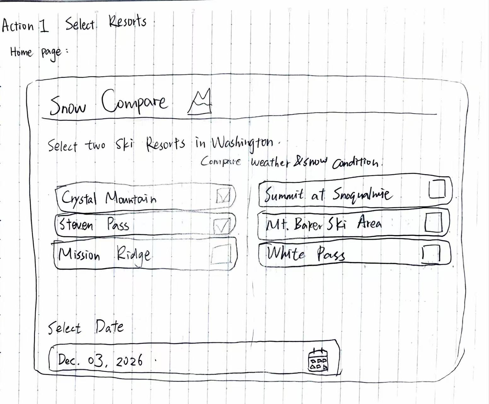
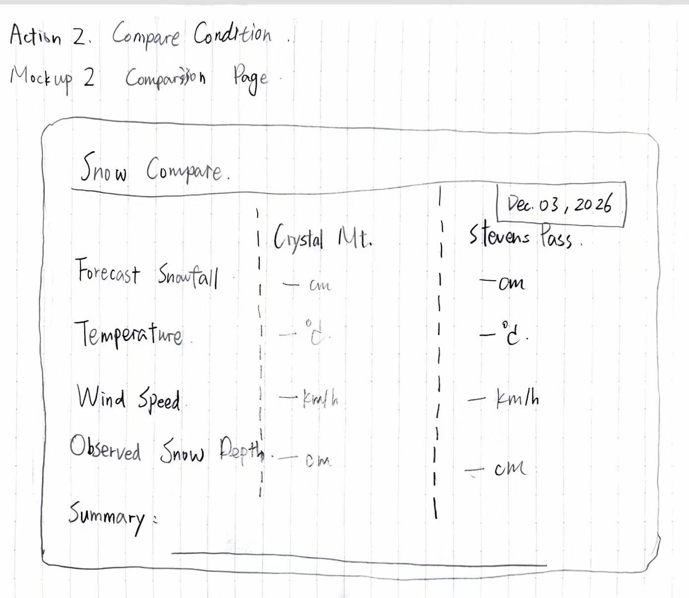
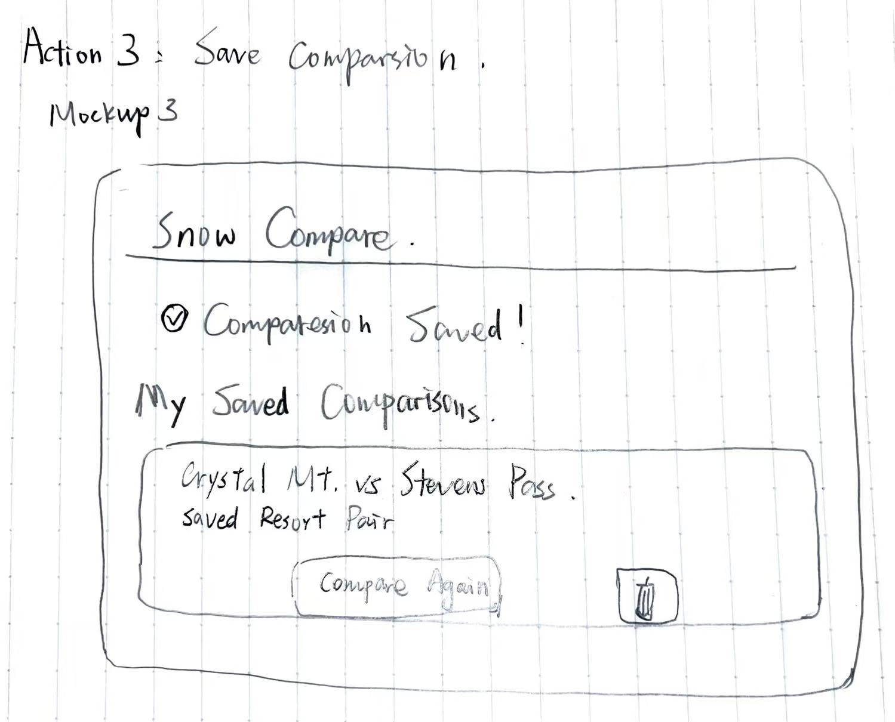

# P2 Proposal — Snow Compare

**Course:** HCDE 310  
**Team:** Murphy Jiang, Ruihan Gao
**Selected concept:** Snow Compare  
**Depth item:** Many Lenses  
**Data sources:** Open-Meteo + USDA NRCS SNOTEL (AWDB)

## 1. Design problem, audience and value (3–5 sentences) — Member A

Snow Compare is designed for skiers and snowboarders in Washington State who are planning their next ski trip and deciding between resorts. These users want to compare expected snowfall and wind with the snow already on the ground, but forecast and observed snowpack information may live on different websites. Our app combines forecasts from Open-Meteo with observations from a nearby SNOTEL station, clearly labeling the source, elevation, and observation time of each measurement. A side-by-side comparison and plain-language summary help users understand trade-offs without switching between multiple tabs or mistaking nearby station data for official resort conditions.

## 2. Depth item (2–3 sentences) — Member A

We chose **Many Lenses** as our depth item because Snow Compare combines weather forecasts from Open-Meteo and snow observations from nearby SNOTEL stations. Our app will display forecast snowfall, temperature, wind speed, and observed snow depth in side-by-side comparison charts, helping users understand the differences between ski resorts. By combining these data sources, users can compare both future weather and current snow conditions in one place to make better decisions about where to ski.

## 3. Main user flow — Member A

### Action 1 — Select resorts

| Step | The user... | The app... | They see... |
| --- | --- | --- | --- |
| 1 | opens Snow Compare | loads the supported resort list and saved choices | two labeled resort selectors |
| 2 | selects Crystal Mountain and Stevens Pass | stores selections for the current request and checks for duplicates | selected names and a Compare button |
| 3 | selects a forecast date and clicks Compare | validates inputs and begins fetching both data types | a loading message or clear correction prompt |

**Original hand-drawn mockup:** 

**State notes:** Empty: ask users to select two resorts. Loading: show “Loading conditions...”. Error: Show "Unable to load resorts."

### Action 2 — Compare forecasts and observed snowpack

| Step | The user... | The app... | They see... |
| --- | --- | --- | --- |
| 1 | opens the comparison | requests Open-Meteo forecasts and nearby SNOTEL observations | separate loading indicators for forecast and observations |
| 2 | reads both resort cards | aligns forecasts by selected date and labels station measurements by location, elevation and timestamp | predicted snowfall, temperature and wind, plus nearby measured snow depth if available |
| 3 | reads the conditions summary | compares available forecast numbers using simple Python rules, without declaring which mountain has better snow | plain-language trade-offs and warnings about missing or non-resort observations |

**Original hand-drawn mockup:** 

**State notes:** Empty: Show "No snow data available." Loading: Show "Loading weather and snow data..." Error: Show "Some data could not be loaded."

**Important data distinction:** SNOTEL stations are near resorts, not necessarily on-resort. Do not label station measurements as official resort snow depth or compare station values without showing relevant context.

### Action 3 — Save a comparison

| Step | The user... | The app... | They see... |
| --- | --- | --- | --- |
| 1 | clicks Save Comparison | validates and writes resort IDs to a local JSON file | “Comparison saved” confirmation or error |
| 2 | returns later | reads saved resorts from JSON | saved resort pair on the homepage |
| 3 | opens the saved pair | requests new live forecasts and latest available station observations | refreshed conditions, not stale copied weather values |

**Original hand-drawn mockup:** 

**State notes:** Empty: “No saved comparisons yet.” Loading: “Saving...”  Error: “Could not save your comparison; please try again.”

## 4. Data sources — Member B

### Source 1: Open-Meteo Weather Forecast API

**Documentation:** https://open-meteo.com/en/docs

**What we use it for:**

We use Open-Meteo in Action 2 (Compare Forecasts and Observed Snowpack) to retrieve weather forecasts for each selected ski resort. The app uses daily snowfall, maximum and minimum temperatures, and precipitation, along with hourly relative humidity and wind speed.

**Key or limits:**

No API key or account is required for non-commercial use. The free service allows up to 10,000 API calls per day. Attribution is required under the CC BY 4.0 license.

**The call:**

Endpoint: `https://api.open-meteo.com/v1/forecast`

Parameters used in our test:

```json
{
  "latitude": 46.9305,
  "longitude": -121.4758,
  "daily": "snowfall_sum,temperature_2m_max,temperature_2m_min,precipitation_sum",
  "hourly": "relative_humidity_2m,wind_speed_10m",
  "forecast_days": 3,
  "temperature_unit": "fahrenheit",
  "wind_speed_unit": "mph",
  "timezone": "America/Los_Angeles"
}
```

**One real response (trimmed):**

```json
{
  "latitude": 46.90286,
  "longitude": -121.437416,
  "elevation": 1381.0,
  "timezone": "America/Los_Angeles",
  "daily": {
    "time": ["2026-11-22", "2026-11-23", "2026-11-24"],
    "snowfall_sum": [0.0, 2.17, 2.94],
    "temperature_2m_max": [29.5, 35.6, 34.4],
    "temperature_2m_min": [23.3, 23.0, 28.7],
    "precipitation_sum": [0.0, 3.3, 13.98]
  },
  "hourly": {
    "time": [
      "2026-11-22T00:00",
      "2026-11-22T01:00",
      "2026-11-22T02:00"
    ],
    "relative_humidity_2m": [85, 83, 85],
    "wind_speed_10m": [4.7, 4.0, 5.1]
  }
}
```

**What we noticed:**

The API returned the requested daily and hourly variables successfully. Daily snowfall is measured in centimeters, temperature in Fahrenheit, precipitation in millimeters, humidity in percent, and wind speed in miles per hour. The returned coordinates differ slightly from the requested coordinates because the API uses a weather model grid point. This means the forecast represents an approximate location rather than measurements taken directly across the ski resort.

### Source 2: USDA NRCS Air and Water Database (AWDB) REST API

**Documentation:** https://wcc.sc.egov.usda.gov/awdbRestApi/swagger-ui/index.html

**What we use it for:**

We use the NRCS AWDB REST API in Action 2 (Compare Forecasts and Observed Snowpack) to retrieve snowpack observations from nearby SNOTEL stations. We use Snow Depth (`SNWD`) and Snow Water Equivalent (`WTEQ`) to help users understand recent snow conditions. For our MVP, Crystal Mountain is associated with Morse Lake, and Stevens Pass is associated with the Stevens Pass SNOTEL station.

**Key or limits:**

Our test requests succeeded without an API key. We did not find a clearly documented public rate limit, so the app will avoid unnecessary repeated requests and handle temporary service errors. We also experienced an HTTP 503 error during testing, but retrying the request succeeded.

**The call:**

Endpoint: `https://wcc.sc.egov.usda.gov/awdbRestApi/services/v1/data`

#### Crystal Mountain — Morse Lake

**Station metadata:**

- Station triplet: `642:WA:SNTL`
- Station name: Morse Lake
- Elevation: 5,400 ft
- Coordinates: `46.90585, -121.4827`

**Request parameters:**

```json
{
  "stationTriplets": "642:WA:SNTL",
  "beginDate": "2026-11-14",
  "endDate": "2026-11-21",
  "elements": "SNWD,WTEQ",
  "duration": "DAILY"
}
```

**Trimmed response (actual API data):**

```json
[
  {
    "stationTriplet": "642:WA:SNTL",
    "data": [
      {
        "stationElement": {
          "elementCode": "SNWD",
          "durationName": "DAILY",
          "storedUnitCode": "in"
        },
        "values": [
          {"date": "2026-11-14", "value": 6},
          {"date": "2026-11-15", "value": 8},
          {"date": "2026-11-16", "value": 8},
          {"date": "2026-11-17", "value": 5},
          {"date": "2026-11-18", "value": 8},
          {"date": "2026-11-19", "value": 10},
          {"date": "2026-11-20", "value": 10},
          {"date": "2026-11-21", "value": 12}
        ]
      },
      {
        "stationElement": {
          "elementCode": "WTEQ",
          "durationName": "DAILY",
          "storedUnitCode": "in"
        },
        "values": [
          {"date": "2026-11-14", "value": 2.7},
          {"date": "2026-11-15", "value": 2.8},
          {"date": "2026-11-16", "value": 2.9},
          {"date": "2026-11-17", "value": 2.9},
          {"date": "2026-11-18", "value": 3.0},
          {"date": "2026-11-19", "value": 3.2},
          {"date": "2026-11-20", "value": 3.1},
          {"date": "2026-11-21", "value": 3.2}
        ]
      }
    ]
  }
]
```

#### Stevens Pass — Stevens Pass SNOTEL

**Station metadata:**

- Station triplet: `791:WA:SNTL`
- Station name: Stevens Pass
- Elevation: 3,940 ft
- Coordinates: `47.74607, -121.09288`
- Reporting since: 1979-10-01

**Request parameters:**

```json
{
  "stationTriplets": "791:WA:SNTL",
  "beginDate": "2026-11-20",
  "endDate": "2026-11-21",
  "elements": "SNWD,WTEQ",
  "duration": "DAILY"
}
```

**Trimmed response (actual API data):**

```json
[
  {
    "stationTriplet": "791:WA:SNTL",
    "data": [
      {
        "stationElement": {
          "elementCode": "SNWD",
          "durationName": "DAILY",
          "storedUnitCode": "in"
        },
        "values": [
          {"date": "2026-11-20", "value": 0},
          {"date": "2026-11-21", "value": 1}
        ]
      },
      {
        "stationElement": {
          "elementCode": "WTEQ",
          "durationName": "DAILY",
          "storedUnitCode": "in"
        },
        "values": [
          {"date": "2026-11-20", "value": 0.0},
          {"date": "2026-11-21", "value": 0.1}
        ]
      }
    ]
  }
]
```

**What we noticed:**

The AWDB API returned both snow depth (`SNWD`) and snow-water equivalent (`WTEQ`) for both selected stations. At Morse Lake, snow depth increased from 6 inches on November 14 to 12 inches on November 21, while SWE increased from 2.7 to 3.2 inches. At Stevens Pass, snow depth increased from 0 inches on November 20 to 1 inch on November 21, while SWE increased from 0.0 to 0.1 inches.

The two stations provide observations over different date ranges, so their values should not be treated as measurements from the same dates. The time-series response identifies the station by its triplet but does not include descriptive station metadata, so we retrieved station information separately. These measurements represent conditions at the named SNOTEL stations, not official ski resort snow reports. The app should display the station name, elevation, and observation date alongside each measurement.

The response reports snow depth in whole inches and SWE to one decimal place. We also experienced an HTTP 503 error during the first request, but a retry succeeded. Therefore, the app should handle temporary API failures gracefully and avoid treating missing measurements as zero.

## 5. Data Model — Member B

### Data Entities

| Noun | What it holds | Saved? Why? |
|---|---|---|
| **Resort** | `id`, `name`, `latitude`, `longitude`, `station_id` (ID of its selected nearby SNOTEL station) | Yes, in `data/resorts.json`. This file stores the app's supported resorts, their coordinates, and selected station mappings. It acts as the app's local configuration. |
| **Forecast** | `resort_id`, `forecast_date`, `snowfall_cm`, `temperature_max_f`, `temperature_min_f`, `precipitation_mm`, `wind_speed_mph`, `retrieved_at` | No. Forecasts are retrieved from Open-Meteo when a comparison is requested, so the app can display updated weather information rather than relying on outdated saved values. |
| **SNOTEL Station** | `station_id`, `name`, `state_code`, `network_code`, `latitude`, `longitude`, `elevation_ft`, `distance_km` | Station metadata is stored as part of the resort-to-station mapping in `data/resorts.json`. The distance is calculated from the resort reference coordinates and station coordinates when needed. This provides location and elevation context for each observation. |
| **Snow Observation** | `station_id`, `observation_date`, `snow_depth_in`, `swe_in`, `retrieved_at` | No. Snow observations are requested from the NRCS AWDB API when a comparison is made. Missing measurements are represented as `null` rather than treated as zero. |
| **Saved Comparison** | `resort_a_id`, `resort_b_id`, `created_at` | Yes, in `data/saved_comparisons.json`. Only the selected resort IDs and save time are stored, allowing users to reopen a comparison without preserving outdated weather or snow observations. |

### Relationships

- Each **Resort** is associated with one selected nearby **SNOTEL Station** through `station_id` for the MVP.
- One **SNOTEL Station** can provide multiple **Snow Observations** over different dates.
- Each **Resort** can have multiple **Forecast** records for different forecast dates.
- A **Saved Comparison** contains two resort IDs. When reopened, the app retrieves fresh forecasts and the latest available SNOTEL observations for those resorts.
- Forecasts and snow observations remain separate data types because they come from different sources and describe different time periods: forecast conditions versus measurements recorded at a nearby station.

### Data Storage

The app uses two local JSON files:

- `data/resorts.json`: Stores the supported resort list, resort coordinates, and selected nearby SNOTEL station metadata. For the MVP, Crystal Mountain is mapped to Morse Lake (`642:WA:SNTL`), and Stevens Pass is mapped to Stevens Pass (`791:WA:SNTL`). Each mapping includes the station name, coordinates, and elevation.
- `data/saved_comparisons.json`: Stores users' saved resort pairs and their creation times. Weather forecasts and snow observations are not stored here because they should be refreshed when a comparison is opened.

**Unit conventions:** Open-Meteo forecast values are stored using the units returned by the API: snowfall in centimeters (cm), temperature in Fahrenheit (°F), precipitation in millimeters (mm), and wind speed in miles per hour (mph). SNOTEL snow depth and snow-water equivalent (SWE) are stored in inches (in), matching the API's `storedUnitCode`. The interface should display the corresponding units clearly.

**Data accuracy:** SNOTEL measurements represent conditions at the named observation station, not official ski resort snow reports. The app therefore displays the station name, elevation, distance from the resort reference point, and observation date alongside its measurements. Station distance and elevation provide context for interpreting the observations; they do not guarantee that the station represents conditions across the entire resort. If a station or measurement is unavailable, the app displays an appropriate missing-data message instead of inventing a value.

## 6. Tech Plan — Member B

We plan to build Snow Compare using Python and Flask. The application will retrieve forecast data from the Open-Meteo API and snowpack observations from the USDA NRCS AWDB REST API. We will organize the project into separate modules for API requests, data processing, and application routes so that each part can be tested independently.

### Planned Project Structure

| File | Responsibility |
|---|---|
| `app.py` | Runs the Flask application and defines the main application routes |
| `open_meteo.py` | Requests weather forecast data from the Open-Meteo API |
| `nrcs.py` | Requests snow depth and snow-water equivalent observations from the NRCS AWDB API |
| `resorts.py` | Loads supported resorts and their selected nearby SNOTEL station mappings |
| `data/resorts.json` | Stores resort coordinates and selected nearby-station metadata |
| `templates/index.html` | Displays the main resort comparison interface |
| `static/style.css` | Defines the visual layout and styling |
| `static/script.js` | Handles client-side interactions, including resort selection and saved comparisons |

### Data Processing Plan

1. Retrieve forecast data for each selected resort using its latitude and longitude.
2. Retrieve daily snow depth (`SNWD`) and snow-water equivalent (`WTEQ`) observations from the corresponding SNOTEL station through the NRCS AWDB API.
3. Normalize the returned data into consistent structures for display.
4. Clearly label forecast dates, observation dates, units, and station locations so users can distinguish forecasted conditions from measured snowpack.
5. Handle API errors and missing observations gracefully, displaying an informative message instead of causing the application to fail.

We will keep the API request logic separate from the Flask routes and user interface. This structure will make the application easier to debug, test, and extend.

## 7. Who we will test with — Member A

| Audience role (not name) | How we will reach them | Planned testing date |
| --- | --- | --- |
| UW student who frequently snowboards in Washington | personal network / student outdoor club | 11/27 |
| Recreational skier who regularly compares Washington resorts | personal network | 11/27 |
| Newer skier or snowboarder planning a weekend trip | personal network or local ski community | 11/27 |

All three are target users, not recruited simply because they are HCDE classmates. Each will try the app themselves while the team observes without controlling the keyboard.

## 8. Success criteria — A: people / B: code

**Code (Member B):**

1. A valid two-resort comparison displays date-labeled Open-Meteo forecasts for both resorts, including snowfall (cm), temperature (°F), and wind speed (mph). Invalid selections and API failures return useful messages rather than causing the application to crash.

2. **Many Lenses:** Each resort's result visibly distinguishes its forecast from measured SNOTEL observations, including station name, observation date, elevation, and distance when available. If observation data is unavailable, the app clearly says so rather than implying a current on-mountain snow report.

3. Saving a valid resort pair writes `data/saved_comparisons.json`, and reopening the homepage restores that pair.

**People (Member A):**

1. At least 2 of 3 users can select and compare two resorts in 3 minutes without assistance.
2. At least 2 of 3 users can correctly explain the difference between **forecast snowfall** and **observed snow depth from a nearby station** after viewing the comparison screen.
3. At least 2 of 3 users can save and reopen a resort pair without assistance.

## 9. Priorities and risks — Member B, reviewed with A

**Must-have (ordered):**

1. Validated selection of two different resorts.
2. Open-Meteo forecasts for both selected resorts.
3. A selected nearby SNOTEL station mapping for each resort, with an honest unavailable-data state if no suitable station or observation is available.
4. AWDB observation requests with graceful handling of missing or stale measurements.
5. A clear side-by-side Many Lenses display that distinguishes forecasts from nearby station observations and shows relevant source information.
6. JSON-based saving and reloading of resort pairs.
7. Three accessibility checks: visible labels and error messages, keyboard navigation with visible focus, and information that does not rely on color alone.
8. A runnable README and safe `.env` handling in P3.

**Nice-to-have (highest priority first):**

1. Visual charts for comparing snowfall and weather trends.
2. Support for additional Washington ski resorts.
3. A longer forecast date range.
4. Optional personalized weighting of weather and snow conditions.

Features will be cut from the bottom of this list if development time is limited.

**Risks and early tests:**

1. **Station coverage mismatch:** Nearby SNOTEL stations may be located at different elevations or may not fully represent conditions across a ski resort. Our initial tests identified Morse Lake (`642:WA:SNTL`, 5,400 ft) as the selected station for Crystal Mountain and Stevens Pass (`791:WA:SNTL`, 3,940 ft) as the selected station for Stevens Pass. Early test: use the resort and station coordinates to calculate their distance, compare their elevations, and review the available observation dates and values. These checks provide context for interpreting the station measurements but do not establish that a station represents conditions across the entire resort. The app will identify the station and its location context clearly. If a station is unavailable or unsuitable, the app will display an unavailable-data state rather than presenting an unrelated measurement as resort conditions.

2. **Data mismatch or API outage:** Forecast dates may not align with observation timestamps, or an external service may return missing data, stale measurements, or an error. Early test: inspect actual API responses, compare their timestamps and units, and test missing-data and API-failure cases. Verify that the app labels each data source and time period correctly and preserves any successfully retrieved data when the other source fails.

## 10. AI Plan — Both

We will use AI as a supporting tool throughout the project, including organizing the proposal, reviewing interaction flows and data models, suggesting Python/Flask implementation approaches, and identifying potential errors and test cases.

We will remain responsible for all project decisions and verification. Both members will independently review AI-generated suggestions before using them. We will run the Open-Meteo and NRCS AWDB API requests ourselves, verify data fields and values against actual API responses, and ensure that all technical claims are supported by our evidence. We will also create our own original sketches and make the final design decisions.

During implementation, we will test AI-assisted code against the success criteria in Section 8, including API error handling, missing data, and saved comparisons. We will conduct usability testing with three real users and independently interpret their feedback. AI will not replace direct user observation, testing, or our judgment when evaluating participant feedback.

Actual AI usage, generated suggestions, and our review or modifications will be documented in `P2/ai_use.md`.

## 11. Pairs — Both

| Member | Owner of proposal parts and files | How we avoid conflicts |
|---|---|---|
| **Member A — Product & UX (Murphy Jiang)** | Sections 1–3, Section 7, People criteria in Section 8; `P2/drafts/member_a_ux.md`; original sketches in `P2/mockups/` | A drafts UX-related content separately and shares it with B before integration. A is responsible for the original mockups and UX consistency. |
| **Member B — Technical & Data (Ruihan Gao)** | Sections 4–6, Code criteria in Section 8, Section 9; `P2/drafts/member_b_tech.md`; API evidence in `P2/evidence/`; `.github/copilot-instructions.md`; `.gitignore` | B drafts technical content separately and shares it with A before integration. B verifies API evidence, data accuracy, and technical consistency. |
| **Both** | Sections 10–11; `P2/ai_use.md`; final review, Git commit, and Canvas submission | Both members review and approve the final proposal. Only one member integrates changes into `P2/p2.md` at a time to avoid conflicting edits. Both review the final version before submission. |